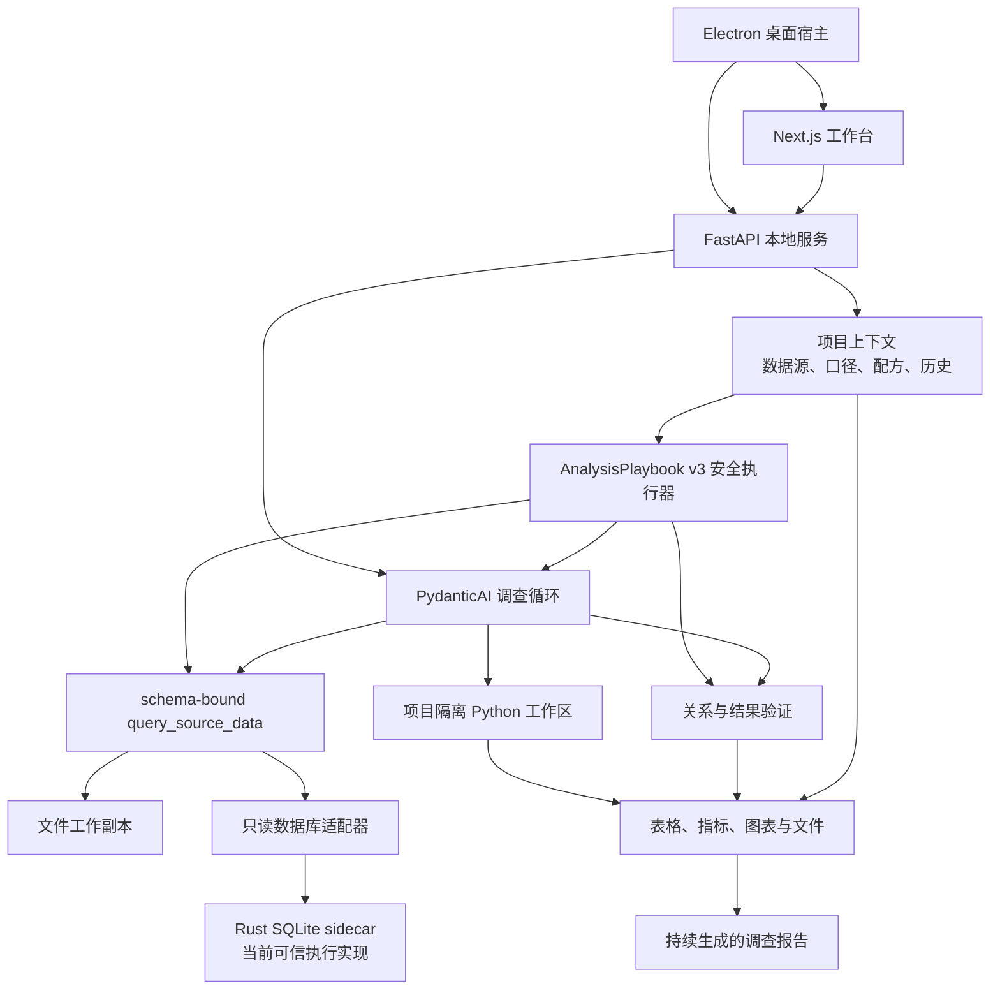

# ReceiptBI 架构

> 本文描述当前维护的 `apps/` 运行时与 `crates/` Rust 执行底座。能力完成度以 [`../STATUS.md`](../STATUS.md) 为准。

## 核心分工

ReceiptBI 不是“模型先写一段 SQL，再固定执行一段 Python”的流水线。它把职责拆成三个边界明确、可分别增强的层：

- **Rust：可信数据执行底座。** 系统负责只读、资源限制、取消、来源身份和结果边界，不把这些要求交给模型记忆。当前已落地的第一块是桌面打包链中的 SQLite sidecar；文件、MySQL 和 PostgreSQL 仍经过 Python 服务内的受控适配器，尚未全部迁入 Rust。
- **Python：开放分析环境。** FastAPI、数据预检、结构化查询编译和项目隔离 Python 工作区负责清洗、统计、转换以及长尾图表。Python 是分析能力层，不是可信边界的唯一所有者。
- **系统执行器：窄而确定的复用通道。** AnalysisPlaybook v3 只有在单一逻辑来源、单个类型化查询和一次最终校验的严格形态下，才会在模型之前由系统重新绑定当前来源、重新编译并执行；复杂方法继续交给 Agent 重新规划。
- **Agent：调查编排与解释。** PydanticAI Agent 根据问题和中间发现，自主选择结构化查询、原始只读查询、Python、关系验证和结果验证，可以多轮改变方向；对于系统已执行并校验的 v3 结果，Agent 只解释和呈现这份当前结果，不再重新读取来源替换它。

这套分工允许模型能力有差异：模型影响调查深度和方向，系统仍掌握数据读取、字段绑定、只读执行、关系启用、证据记录与完成条件。

## Harness 重构边界

| 边界 | 当前落地 | 后续替换工作 |
|---|---|---|
| 模型引擎 | `model_engine.py` 的 `model_session` 按任务管理连接池；显式协议选择 Chat Completions、Responses 或 Anthropic 适配器，支持借用外部 `Model` / HTTP 客户端 | 供应商模型目录、上下文与图像等逐模型能力发现 |
| 任务控制 | `run_control.py` 收束子任务、统一截止时间与停止检查；关键写入等待真实结果后传播取消 | 前端活动展示与运行状态统一 |
| 数据工具 | `query_compiler.py` 编译、`file_query.py` 读取、`result_profile.py` 校验结果；Agent 与保存方法执行器复用同一实现 | 收敛来源查询的取消和资源生命周期 |
| 工具与会话 | `analyst/toolsets.py` 组合 15 个独立工具；`session.py` 持有调查状态；`analyst/recovery.py` 校验并装入快照；`analysis_run_recovery.py` 处理启动遗留运行 | 持续分析及语义后台任务的恢复协调 |
| 数据合同 | `models/analysis.py`、`query.py`、`analysis_state.py` 定义报告、工具输入与调查状态；journal 统一运行写入；`analysis_continuation.py` 判断接续方式；completion 原子提交结果与聊天记录 | 未引用产物回收 |

这不是“已经可随意切换 Codex/Hermes/Pi 引擎”的声明。当前直接复用已安装的 PydanticAI；外部编程 Agent 没有接入，也没有新增运行时依赖。

`model_runtime.py` 将已选服务解析为唯一的 `ResolvedModelConfig`：供应商身份与 API 协议分开，地址只规范化一次，凭证及请求参数在任务内固定。执行服务、建议生成与连接检查直接传递此对象；模型引擎不再猜默认值。普通运行快照只含服务名称与身份，诊断按需追加模型标识、供应商和协议。

Groq 使用官方 OpenAI 兼容地址；Qwen 要求填写与密钥同地域的百炼工作空间地址。未做供应商真实 API 调用，离线 SDK 测试不能证明账号、配额或具体模型在线可用。

调查、报告草稿、问题建议、语义文案和连接检查都通过 `model_session` 调用模型。连接池只在实际调用时创建，同一任务内的工具轮次复用；完成、异常、超时或取消后释放。等待业务确认和只创建建议回调不会分配连接。调用方注入的模型或 HTTP 客户端仍由调用方关闭，不跨任务缓存凭证。

`model_probe.py` 独立检查分析所需的工具往返和结构化输出，复用同一引擎与 PydanticAI 的 Tool Output、输出校验器。检查只使用临时值，不读取项目数据；最多三次模型请求、一次工具执行，整体截止时间为 30 秒。普通文字回复或臆造结果不能通过，失败分别归类为工具调用、结果格式、凭证或连接问题。路由在远端请求前释放数据库事务，检查结果仅写回原配置版本；配置、已有检查结果被更新或模型被删除时返回冲突，不覆盖现状。通过只证明本次基础能力检查，不保证任意调查质量或后续服务可用性。前端逐服务回执、失效和展示合同见 [分析服务目录](../MODEL_SERVICES.md)。

调查流逐层拥有下层资源：`AnalysisStreamResponse` 关闭聊天流，聊天流关闭执行流，执行流关闭运行时，运行时先收束模型任务再清理 Python 工作区。提前关闭、处理事件失败与 ASGI 断连都经过同一释放链；异步清理和中断记录不受 ASGI 已取消作用域再次打断。

`analysis_run_journal.py` 串行处理同一轮次的进度、检查点、完成和中断；条件行锁匹配轮次与可写状态，再读取当前元数据，旧轮次不能覆盖接续任务。检查点先写不可变文件，再短事务挂接回执；保留运行上下文，不携带旧续跑标记。已开始的落盘与回执提交一起结束后才传播取消。创建与接续在提交前记录运行身份，提交期间取消仍可正确暂停。`analysis_continuation.py` 统一判断预备任务、业务确认、补充数据和安全快照的接续，不访问数据库或模型；接续判断在行锁内使用当前状态，不从旧 ORM 对象复制。引擎启动前结束读取事务，只向引擎传保存回调。

`analysis_run_recovery.py` 将启动遗留运行和恢复提示逐项原子提交；启动扫描的文件核对在事务外完成，挂接前重新匹配轮次、状态、更新时间和检查点。检查期间有变化的运行不被覆盖。尚未执行的预备持续分析保持原状；已确认但尚无快照的接续保留继续入口，不声称保存了工具步骤。断连提示复用此模块，按运行与轮次去重，同一事务内重复调用也只写一条。文件模块不再处理聊天或运行状态；凭证准备、调查恢复和其他后台任务恢复各自完成提交。

`analysis_completion.py` 是 journal 与聊天共用的提交单元。执行服务准备报告、产物记录及语义变更，`ChatTurn` 从事件副本生成聊天记录，随后一次提交。正常结果、待确认、校验拒绝和已验证表格报告共用此入口；无项目聊天也提交完整终态批次。准备失败回滚整批变更，终态只在提交成功后发送；提交开始后的取消等待真实结果，不把已完成任务改写成中断。数据库回执失败或轮次被替换后可能留下未引用检查点，不能在提交结果不明时删除文件；这类文件和回滚后的图像回收仍待统一。

`conversation_state.py` 单独管理会话当前态。每次请求把轮次标识写入现有会话元数据，运行检查点保留同一标识；后续上下文、完成、错误和恢复只在归属匹配时更新会话。条件 UPDATE 在事务内取得当前行，避免从旧 ORM 对象复制过期元数据；历史消息仍归各自轮次保存。断连只处理执行服务记录的本轮 run，旧轮次不能把已恢复的新轮次标成失败。恢复消息按 run 与轮次去重；没有轮次标识的历史任务只追加恢复消息，不猜测当前会话归属。注册表先判定请求是否有效，重复、已释放或预先停止的流不能挤掉现有任务；释放最新任务也不恢复旧任务的所有权。

`checkpoint_contract.py` 只定义检查点值、版本、错误与稳定哈希，不依赖数据库、文件存储或模型 SDK。`analysis_checkpoint.py` 负责落盘、完整性读取与数据库结果重新核对；执行服务将 `RestoredCheckpoint` 直接传给运行时，不再转换成无类型字典。`analyst/recovery.py` 按查询、关联、汇总、业务规则、结果和图表分别校验工具记录，随后把独立副本一次性装入空会话。校验失败不装入旧记录或候选知识；恢复后的行、元数据和记录不与检查点或其他会话共享可变对象。自由 Python 状态仍不可恢复。

`AnalysisState` 保留五种业务状态。进度通过 `analysis_state` 更新当前运行，`stage` / `step` 只描述工作；检查点携带同一状态，终态仍须等待结果持久化。缺失、非终态或与报告不符的结果状态不能写成完成。前端状态类型由 `scripts/generate-analysis-state.py` 生成；进度组件只按状态与已登记工作步骤选择本地文案，不解析服务端提示。“正在停止”和“正在整理结果”是客户端等待状态，不新增数据库状态。

### 成熟实现的取舍依据

- [Pi agent loop](https://github.com/badlogic/pi-mono/blob/main/packages/agent/src/agent-loop.ts)：在模型调用边界注入模型/流函数，业务消息不直接绑定某家 SDK。这里采用依赖注入原则，不复制 TypeScript 循环。
- [Pi contracts](https://github.com/badlogic/pi-mono/blob/main/packages/agent/src/types.ts) 与 [模型类型](https://github.com/badlogic/pi-mono/blob/main/packages/ai/src/types.ts)：分别定义供应商、协议、配置、工具和循环。ReceiptBI 使用领域类型传递配置与结果，查询及报告 API 不反向依赖分析 Agent；未复制第三方源码。
- [Codex App Server](https://openai.com/index/unlocking-the-codex-harness/)：线程、轮次、事件分别有明确生命周期，客户端消费稳定事件。作为后续任务合同的参考，当前未移植其 JSON-RPC 服务。
- [Codex Turn 合同](https://github.com/openai/codex/blob/main/codex-rs/app-server-protocol/schema/typescript/v2/Turn.ts)：运行状态与条目分开，客户端使用生成的类型；ReceiptBI 采用状态单一来源与前端生成物，不复制外部业务状态或依赖。
- [Codex 任务清理](https://github.com/openai/codex/blob/main/codex-rs/core/src/tasks/mod.rs)：参考按 turn id 中止任务、仅在原任务仍占用当前槽位时清理的方式；持久回写采用 [SQLAlchemy 条件版本更新](https://docs.sqlalchemy.org/en/20/orm/versioning.html) 的匹配原则，使用现有 JSON 中的轮次而非新增版本列。未复制 Rust 代码，数据库交错行为本轮只实测 SQLite。
- [Hermes agent loop](https://hermes-agent.nousresearch.com/docs/developer-guide/agent-loop)：调用可中断，工具结果回到任务状态。ReceiptBI 共享可变分析状态的工具仍顺序执行，不照搬并发策略。
- [PydanticAI models](https://pydantic.dev/docs/ai/models/openai/)：直接复用现有依赖中的协议、工具循环、结构化输出与 DeepSeek profile，没有拷贝第三方实现到仓库。
- [PydanticAI 连接所有权](https://pydantic.dev/docs/ai/models/overview/#http-client-lifecycle) 与 [HTTPX 异步连接池](https://www.python-httpx.org/async/#opening-and-closing-clients)：采用任务作用域和显式借用，复用已安装 PydanticAI 1.107.1 的客户端工厂，不在工具循环里逐轮建连接。
- [LangGraph checkpointers](https://docs.langchain.com/oss/python/langgraph/checkpointers#checkpoints)：参考在完整步骤边界保存状态快照、恢复成功步骤的分工；ReceiptBI 继续使用已有磁盘检查点与确定性校验，没有引入 LangGraph，也不重放模型思维。
- [SQLAlchemy AsyncSession 并发约束](https://docs.sqlalchemy.org/en/20/orm/extensions/asyncio.html#using-asyncsession-with-concurrent-tasks)：同一 Session 不可并发操作；ReceiptBI 通过单一 journal 串行访问，保留报告与聊天的共同事务，结果层只 flush。关键写入复用 [asyncio shield](https://docs.python.org/3/library/asyncio-task.html#shielding-from-cancellation)，等待实际结束后再传播取消。
- [PydanticAI Tool Output 与输出校验](https://pydantic.dev/docs/ai/core-concepts/output/#tool-output)：连接检查使用与调查一致的类型化输出；基础工具循环按 [Groq 官方流程](https://console.groq.com/docs/tool-use/overview#how-tool-use-works) 验证工具返回值再次进入模型，不把模型列表或纯文字当作分析能力证据。
- [PydanticAI toolsets](https://pydantic.dev/docs/ai/tools-toolsets/toolsets/) 与 [dependencies](https://pydantic.dev/docs/ai/core-concepts/dependencies/)：工具按项目语义、来源查询、结果、关系、知识和可选 Python 六组组合；每次调用通过 `RunContext[AnalystSession]` 取得当前会话，不捕获创建 Agent 时的运行时。工具集保留超时和顺序执行约束，关闭的 Python 能力不向模型发布。
- [Python aclosing](https://docs.python.org/3/library/contextlib.html#aclosing) 与 [AnyIO finalization](https://anyio.readthedocs.io/en/stable/cancellation.html#finalization)：显式关闭提前结束的生成器，只在退出清理期间屏蔽作用域取消；SSE 编码、断连监听和心跳继续复用现有 sse-starlette。
- 接入参数以 [Groq](https://console.groq.com/docs/openai) 与 [百炼](https://help.aliyun.com/zh/model-studio/compatibility-of-openai-with-dashscope) 官方说明为准（核对日期：2026-09-08）。

### 边界验证

在 `apps/api` 按修改边界选择运行：

- `.venv/bin/python -m unittest tests.test_analysis_module_boundaries -q`：数据模块不加载模型 SDK；中文路径下真实 DuckDB 查询与结果校验；注入 TestModel 后的产品报告输出。
- `.venv/bin/python -m unittest tests.test_analyst_recovery -q`：检查点合同与恢复模块的导入边界、中文路径落盘恢复、独立会话副本、无效记录/预算/图表的原子拒绝，以及校验完成后才进入模型。
- `.venv/bin/python -m unittest tests.test_analyst_toolsets -q`：工具不导入模型引擎或调查运行时；同一 Agent 并发执行两个独立项目的文件查询、汇总、校验和报告；检查点快照隔离、不可恢复状态保持和关闭能力不发布。
- `.venv/bin/python -m unittest tests.test_model_session tests.test_model_session_consumers -q`：真实 SDK 配合离线 HTTP transport，检查三种协议的连接复用与释放、失败/停止/超时/取消、外部资源所有权、待确认调查零连接、并发建议各自持有连接。
- `.venv/bin/python -m unittest tests.test_model_configuration tests.test_model_probe -q`：保存配置经解析器分别进入执行和连接检查，验证供应商、协议、地址、请求头及查询参数；检查配置不可变与普通/诊断快照的字段边界，以及真实 SDK 的工具往返、无效输出、超时/取消释放、配置变更后的结果作废和 CI 模拟网关。

- `.venv/bin/python -m unittest tests.test_analysis_stream_lifetime -q`：离线 SDK 请求的提前关闭、事件投影异常、任务与作用域取消；ASGI 发送中和等待事件时断连的清理顺序；聊天提交前不发布终态，发布后断连保留完成状态。
- `.venv/bin/python -m unittest tests.test_analysis_completion -q`：临时中文路径 SQLite 上运行真实执行服务与聊天持久化；验证完成提交与取消、旧轮次晚完成/失败/断连不覆盖新会话、重复流不抢占、同一 run 不同轮次的恢复消息，以及旧中断不改写已恢复的 run。模型及输入准备使用离线替身，不验证云端分析能力。
- `.venv/bin/python -m unittest tests.test_analysis_run_journal -q`：中文路径 SQLite 与真实检查点文件；验证元数据保留、并发进度串行、落盘期间反复取消、旧轮次拒写及无结果泄漏、回执失败保留旧检查点、终态边界和引擎回调接线。
- `.venv/bin/python -m unittest tests.test_analysis_run_lifecycle -q`：各类接续、双请求抢接续、错误归属或确认拒绝、创建与接续提交期间取消、启动遗留运行分类、检查期间轮次变化，以及恢复提示失败回滚与事务内去重。
- `.venv/bin/python -m unittest tests.test_analysis_state_contract -q`：工作步骤和提示文字不决定运行状态；终态先保存后发布；拒绝缺失、活动中或与报告不符的结果状态。在仓库根目录运行 `apps/api/.venv/bin/python scripts/generate-analysis-state.py --check` 核对前端生成物。

以上为离线边界验证，不代替全部业务回归或云端实测。

## 当前组件

### 桌面与前端

- `apps/desktop/electron/` 管理本地 FastAPI 与 Next.js 进程、启动失败界面、IPC 和生命周期。
- `apps/web/src/app/` 提供工作台、设置和关于页面。
- `apps/web/src/components/chat/` 组合项目、数据来源、项目理解与整理记录、横向报告历史、纠正和继续追问。
- 文件来源可以在普通工作台打开可视化整理面板：用户从受控步骤中组合操作，先查看有界的前后样本和变化数量，再明确应用；已有的人工步骤也可以修改或清空。
- 结构化图表使用版本化的 [`CHART_SPEC.md`](CHART_SPEC.md) 合同。Agent 只推荐图型和字段绑定，系统绑定已验证结果，前端用固定 React 组件渲染；报告工作台允许在同一合同内手动调整，而不接受模型生成的 JavaScript 或任意渲染器配置。
- `apps/web/src/lib/report-blocks.ts` 拥有区块模型、来源保留、排版与调查内容转换，不依赖 React 或组件目录。编辑器、阅读联动与报告编排直接使用此模块，不保留组件层转发入口。
- `report-editing.ts` 接受明确页面和类型化动作，统一修改、追加、移动、缩放、复制和删除；无变化返回原对象。工作区只在文档接受动作后更新选择，保存和历史仍由既有编辑会话管理。单卡复制是独立内容，整页复制的来源语义保持原合同。
- 阅读筛选、联动和静态输出见 [报表阅读层](../REPORT_READING.md)；不进入文档历史。普通界面只展示业务状态与依据，技术定义留在高级入口。动作／结果分工参考 [Excalidraw 的 ActionResult](https://github.com/excalidraw/excalidraw/blob/master/packages/excalidraw/actions/types.ts)，未引入其运行时或复制源码。

### 应用与 Agent 层

- `apps/api/app/api/v1/projects.py` 提供项目、来源、预检、语义知识、纠正、分析运行和产物接口。
- `apps/api/app/services/execution.py` 组装模型、项目上下文和分析运行时。
- `apps/api/app/services/analyst_runtime.py` 负责调查指令、预执行和产品事件；工具组合、会话状态、检查点恢复和报告验收位于 `services/analyst/`，详见上方 Harness 边界。
- `apps/api/app/services/analysis_playbook_runner.py` 执行 AnalysisPlaybook v3 的窄安全通道：只接受单来源、单类型化查询和最终校验，绑定当前数据后生成不含 SQL 的执行回执；回执把方法形状、当前来源、结果、画像和校验相互绑定。
- `apps/api/app/services/structured_query.py` 承担该通道复用的结构化查询校验、只读编译与当前来源执行；分析就绪的文件通过 DuckDB 查询，数据库走对应只读适配器。保存的方法只携带声明式查询意图，不保存物理来源 ID 或编译后的 SQL。
- `apps/api/app/services/project_context.py` 只加载当前项目的数据源、候选/已确认/锁定知识与可执行关系，避免跨项目串用。
- `apps/api/app/services/semantic_revisions.py` 把每次语义修改、恢复和来源记录为不可变版本；恢复会生成新版本，旧写入者不能覆盖更新后的 active head。
- `apps/api/app/services/business_decision_slots.py` 为少量已注册的关键业务问题提供系统拥有的稳定身份；只接受显式别名或同时满足多组业务信号的保守映射，旧别名冲突时拒绝自动复用。
- `apps/api/app/services/validated_result_evidence.py` 与 `metric_candidate_learning.py` 从完整保留的最终结果中提取系统可证明的窄语义候选。当前只接受单一结构化查询产生的无筛选、无维度、单指标 `sum/avg`；候选业务含义仍待确认，但其来源绑定、结果哈希和执行验证独立保存，模型 proposal 不能原地改写。
- `apps/api/app/services/sanitation_contract.py` 只接受版本化、有限且可验证的声明式整理操作；未知操作、未来版本或夹带 SQL/Python 的步骤会在读取文件前失败。
- 可视化整理的 preview 在临时目录重跑方法并用 DuckDB 做有界的行列、样本和单元格变化比较，不把整张前后表加载进 Python；apply 会重新执行并核对来源、工作副本、方法 head 和预览证明后才切换当前副本。
- `apps/api/app/services/sanitation_revisions.py` 为整理方法维护不可变修订链和 active head；恢复旧方法会追加修订，但必须重新应用后才会影响当前分析。
- `apps/api/app/api/v1/projects.py` 把 ProjectBundle 中的整理历史保留为无来源、只读的模板；模板先在可丢弃目录试运行，确认时重新核对原文件、当前工作副本、当前 recipe head、模板 head 和输出证明，全部一致后才在来源唯一的 recipe 上追加修订。
- `apps/api/app/services/metric_formula.py` 解释受限的声明式算术表达式，以 Decimal 逐行计算和汇总，不接受 `eval`、Python 片段或模型生成函数。

### 数据执行与分析层

- `apps/api/app/services/data_preflight.py` 对文件执行确定性预检和可重复清洗，保留原件并生成工作副本。
- `apps/api/app/services/file_query.py` 为分析就绪的文件建立受限 DuckDB 表，聚合、筛选和 Join 在本地执行，模型和前端只接收有界结果；这不等于当前所有 CSV/XLSX 预检都已经改成流式 DuckDB 导入。
- `apps/api/app/services/database_value_preflight.py` 在严格表、列、行、字节和时间预算内对数据库做只读抽样画像；它优先使用真实主键/唯一约束提出粒度候选，并把声明外键保留为仍需值验证的关系依据，同时抑制敏感、标识符和高基数原值。
- `apps/api/app/services/database.py` 与 `database_adapters.py` 统一数据库只读访问，并在 SQLite、MySQL、PostgreSQL 可用时读取表类型、字段可空性、主键、外键与唯一约束；获取不到的约束会明确标记为不可用。当前 MySQL、PostgreSQL 和源码模式 SQLite 仍由 Python 适配器执行；取消事件会中断活动查询，PostgreSQL 使用驱动取消，MySQL 使用独立控制连接终止当前查询并在失败时关闭目标连接。
- `crates/sqlite-executor-core/` 与 `crates/sqlite-executor-sidecar/` 提供当前 Rust 可信执行实现；桌面打包时由 `apps/desktop/scripts/build-pyinstaller.ts` 构建并与冻结后端一起分发。
- `apps/api/app/services/python_sandbox.py` 和项目工作区承接开放式计算、统计与图表。自由 Python 产生的进程内状态目前不可安全重放，因此执行过自由 Python 后的检查点会标记为不可恢复。

## 一次调查如何运行

1. 用户在当前项目提出目标；系统加载该项目的数据源、文件预检或数据库约束目录与只读值画像、已确认口径、可执行关系、已提升为项目知识的纠正和可复用分析方法。数据库画像明确标注抽样和预算，声明外键也不能绕过值验证或冒充已验证关系。
2. 若这是绑定 AnalysisPlaybook v3 的持续分析，系统先检查其执行模式。只有“单一逻辑来源 + 单个类型化查询 + 最终校验”的方法会在模型之前绑定当前来源、核对 schema、重新编译执行并生成 SQL-free receipt；复杂、未知或 v2 方法仍标记为 `agent_replan_required`，不会复用旧结果。
3. 没有安全系统执行结果时，Agent 检查数据上下文并选择下一步。常见首选是 `query_source_data`，由系统把来源、字段、筛选、汇总、排序和限制绑定到真实 schema 后编译只读查询。已有系统校验结果时，Agent 只基于该结果组织解释和报告，不再重新查询来源替换它。
4. 当结构化合同表达不了问题时，Agent 可以使用原始只读 SQL 或项目隔离 Python；它也可以在看到结果后继续查询、比较假设或更换图表。
5. 数据执行层实施只读和资源边界。桌面打包的 SQLite 会穿过 Rust sidecar；其他当前路径仍使用受控 Python 适配器。
6. 关系必须先通过匹配率、展开行为等验证才可进入执行上下文；普通任务只能复用已验证关系。验证依据绑定到明确的 source 与 table：筛选、聚合、派生、截断或无法确定表级血缘的结果只对当前运行有效。只有系统对两端完整表级输入进行检查、真实 Join 到达最终结果且 Join 后重新校验，才可升级为长期可执行关系；空键会分别报告非空键匹配质量与全记录覆盖率。
7. 系统持久化报告、表格、指标、ChartSpec 或图像、来源版本、工具记录和校验依据。结构化图表的数据只来自本次已验证结果，模型提供的行、颜色和可执行代码不会进入图表。只有存在本次运行证据时，调查才可声明完成。v3 安全通道的完成还必须包含唯一的系统回执，并逐项匹配当前来源、方法形状、结果指纹、画像与最终校验；普通工具记录或模型文字不能伪造这个回执。若最终结果恰好满足确定性聚合指标的严格形状，系统会额外生成一个待确认候选；该旁路使用独立 savepoint，学习冲突不会反过来破坏已验证报告。
8. 用户可以记录、分类、编辑、撤销纠正，并选择是否提升为当前项目知识。可长期复用的选择来自服务端按原运行证据签发的业务化目标，客户端只持有绑定 run 与语义 active revision 的 opaque ref；整体解释不会被猜成某个内部 key，旧报告也不能覆盖更新后的定义。系统把“记住业务定义”和“已验证可执行”分开；只有当前定义真正作用于最终结果、其真实输出列或关联结果仍由最终结果生产链保留且随后重新校验，纠正重跑才会获得可验证回执。语义修改和恢复都会追加版本，定义发生变化时旧执行证明随之失效。
9. 新一期文件出现阻断漂移时，重复整理只能重试，不能被当成用户批准。工作台要求明确选择“接受这版并用于以后”或继续使用上一可信版本，失败的候选副本不会覆盖可信工作副本。
10. 整理方法的接受、撤销和恢复都会追加不可变修订。恢复只切换方法的 active head，用户必须重新应用后才会改变当前工作数据；ProjectBundle v3 导出和导入保留完整版本链。导入模板不会自动运行，用户必须先查看隔离试运行的变化，再明确绑定到具体来源。
11. 导入模板的预览不写正式 preflight、source 或 recipe；应用时重新执行并校验预览状态。若原文件、可信工作副本、recipe head、模板 head 或输出发生变化，整个事务回滚，原分析副本继续可用。

这个过程是一个可继续的调查循环，而不是固定的 `SQL -> Python -> 图表` 阶段机。Agent 可以少用或不用 Python，也可以在同一次调查中多次调用数据和验证工具。

## 可信边界

Rust 可以成为数据执行底座，但“底座”不等于把整个产品重写成 Rust。当前边界是：

- **系统拥有的确定性能力**：来源身份、原文件保护、结构绑定、只读校验、关系启用、资源限制、结果哈希、证据和完成条件。
- **Rust 当前拥有的执行边界**：打包 SQLite 的允许关系、行数、字节数、超时、取消和来源身份校验。
- **Python 当前拥有的能力**：文件预检与工作副本、数据库适配、统计和开放式分析；其中不属于可信边界的自由 Python 不能被当成可安全重放状态。
- **Agent 拥有的判断**：调查方向、工具选择、假设比较、继续深挖以及如何组织报告。

长期方向是让更多跨数据源读取与资源控制逐步进入统一的 Rust 数据平面，同时保持 Python 分析生态和 Agent 自主性。迁移必须以真实连接器、取消语义和打包验证为依据，不能只凭 crate 或接口存在就宣称完成。

## 持久化与项目隔离

应用元数据由 FastAPI 数据库保存；项目文件、工作副本、依赖和产物保存在项目工作区。项目是以下内容的隔离边界：

- 数据源与版本；
- 预检报告、整理方法的不可变修订历史与当前 active head；
- 候选、已确认与锁定的业务知识；
- 业务知识的不可变修订历史、当前 active head 与恢复来源；
- 用户纠正和可复用分析；
- 调查运行、检查点、报告和产物。

数据库来源默认只读，文件原件不被预检或分析覆盖。使用云模型时，问题、结构、项目口径和完成任务所需的有限结果可能发送给用户选择的模型服务；本地优先不等于绝对离线。

## 当前未完成的架构工作

以下内容尚不能作为已完成能力对外承诺：

- 将 Rust 可信执行从打包 SQLite 扩展到文件、MySQL、PostgreSQL 或统一跨源数据平面；
- 分析就绪文件的查询和清洗预览对比已经使用 DuckDB，但首次 CSV/XLSX/JSON 预检与整理方法重放仍会物化 pandas DataFrame；在完成分块/流式数据平面前，不能对外承诺 500 MB 文件始终不会占用大量内存；
- 数据库真实 PK/FK/唯一约束和字段可空性目录已经落地，运行时关系证据也已区分完整表级证明与当前结果证据；但主动的跨表值域重叠发现、精确全表质量检查和复合关系执行仍未完成；
- 整理方法已具备有限声明式操作、不可变版本、恢复/重新应用、ProjectBundle v3 完整历史、导入模板的隔离预览和显式绑定，以及五类常用操作的可视化 preview-apply 编辑；仍缺更丰富的分布差异、自由组合但仍可证明安全的高级变换，以及让所有恢复/重新应用入口统一走 preview-confirm；
- 工作台已有横向报告历史及项目理解/整理入口，但尚未完成或接入一套完整的 v0.dev 视觉重构；
- 自由 Python 状态的安全恢复；
- AnalysisPlaybook v3 的系统执行目前只覆盖单来源、单类型化查询；确定性语义学习也只覆盖单一当前绑定上的无筛选、无维度 `sum/avg`。多来源关联、原始 SQL、Python、多步变换和更复杂指标仍需 Agent 重新规划或用户治理，不能宣传为全部分析自动复跑或自动理解；
- 已签名、已公证并通过干净机器验证的桌面发行。

详见 [`../STATUS.md`](../STATUS.md)。
